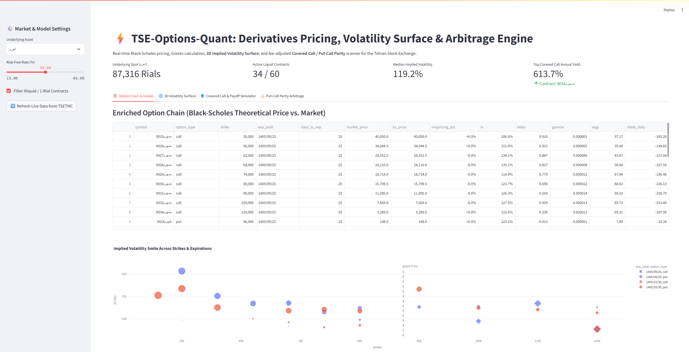
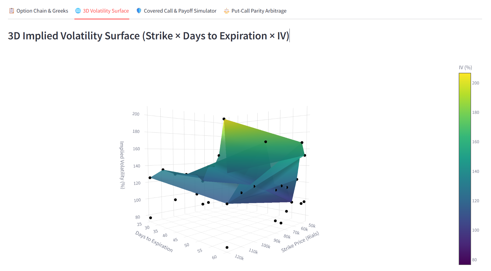
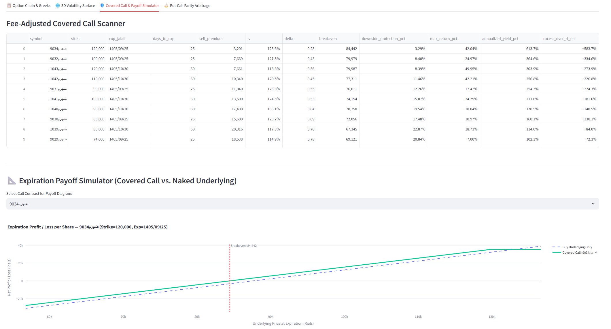

# ⚡ TSE-Options-Quant: Derivatives Pricing, Volatility Surface & Arbitrage Engine

An end-to-end quantitative options analytics, pricing, and arbitrage detection engine built for the **Tehran Stock Exchange (TSE)**. This platform fetches live option chains directly from `TSETMC` APIs, computes theoretical Black-Scholes prices, full Greeks, and numerical Implied Volatility surfaces, and scans for fee-adjusted **Covered Call** and **Put-Call Parity** opportunities.



---

## 🎯 Core Quantitative & Engineering Features

* **Concurrent TSETMC API Client (`src/tse_options_loader.py`):** Resolves active Call (`اختیارخ`) and Put (`اختیارف`) contracts, parses Persian contract titles (`strike` and `Jalali expiration date`), converts dates to time-to-maturity, and fetches live order-book quotes (`Bid / Ask / Last / Volume`) concurrently via `ThreadPoolExecutor`.
* **Vectorized Black-Scholes & Numerical IV (`src/black_scholes.py`):** Computes European option prices and Greeks (`Delta`, `Gamma`, `Vega`, `Daily Theta`, `Rho`) across entire chains using vectorized `NumPy`, and extracts **Implied Volatility (IV)** via Brent's root-finding algorithm (`scipy.optimize.brentq`).
* **Market Microstructure & Fee Modeling (`src/strategies.py`):**
  * Filters illiquid and nominal 1-Rial un-traded contracts to prevent false arbitrage signals.
  * **Covered Call Scanner:** Calculates net debit, breakeven price, downside protection, and annualized yield net of TSE equity (`0.3712%`), option (`0.103%`), and exercise (`0.05%`) fees.
  * **Put-Call Parity Monitor:** Evaluates $C - P = S - K e^{-rT}$ using executable `Bid/Ask` spreads to detect real Conversion/Reversal edges.
* **Interactive 3D Analytics Dashboard (`app.py`):** Built with **Streamlit** and **Plotly**, featuring a **3D Implied Volatility Surface**, volatility smile plots, and an interactive **Expiration Payoff Simulator**.

---

## 🌐 3D Volatility Surface & Strategy Payoff

| 3D Implied Volatility Surface | Covered Call Expiration Payoff |
| :---: | :---: |
|  |  |

---

## 🏗️ Project Structure

```text
TSE-Options-Quant/
├── assets/                     # Dashboard screenshots
├── data/                       # Cached option chain snapshots (options_اهرم.csv)
├── src/
│   ├── black_scholes.py        # Vectorized Black-Scholes, Greeks & Brent IV solver
│   ├── tse_options_loader.py   # Multi-threaded TSETMC API loader & Jalali parser
│   └── strategies.py           # Covered Call & Put-Call Parity arbitrage scanners
├── tests/
│   └── test_black_scholes.py   # Unit tests for Put-Call parity & IV round-trip accuracy
├── app.py                      # Interactive Streamlit + Plotly web application
├── pyproject.toml              # Pytest configuration
└── requirements.txt            # Project dependencies